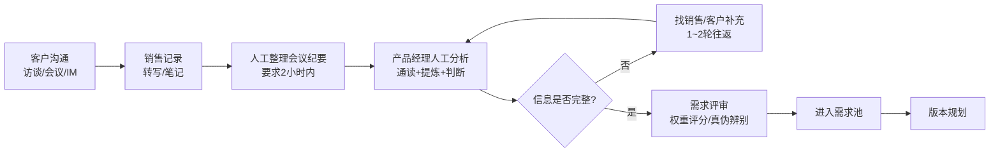

# 03_行业调研

## AI客户需求分析助手｜行业调研文档（v1.0）

> 所属阶段：Step 3 ｜ 状态：初稿待审 ｜ 日期：2026-10-07
> 上游文档：02_用户角色.md ｜ 下游文档：04_竞品分析.md
> 调研方法：公开资料检索，共收集 8 份来源，回答六问后收敛为流程图和 AI 切入点

------

## 1. 调研来源清单

| 编号 | 来源 | 主题 | 可信度评价 |
|---|---|---|---|
| S1 | 人人都是产品经理《产品决策的3个领域——需求决策》 | 需求决策六步法、五维权重优先级模型 | 高，方法论完整 |
| S2 | 人人都是产品经理《B端产品：如何系统地规划需求优先级》 | B端优先级顶层思考、使用者与决策者分离 | 高，B端特性明确 |
| S3 | 中培伟业《产品需求分析的流程》 | 需求收集→整理→分析→排序→文档化全流程 | 中，通用框架 |
| S4 | Stratridge《How to Run Customer Interviews》 | B2B客户访谈结构化方法 | 高，方法具体 |
| S5 | Startupik《Customer Discovery Interviews》 | 发现式访谈、Pain/Frequency/Budget三要素 | 高，实操性强 |
| S6 | 人人都是产品经理《如何做好SaaS二开定制需求》 | SaaS需求确认握手机制、需求落地流程 | 高，一线实践 |
| S7 | 人人文库《客户需求挖掘深度沟通指引》 | 会议纪要规范、需求转化矩阵 | 中，模板类 |
| S8 | 搜狐《软件项目需求反复返工怎么办》+ 海融/Worktile/致远等需求管理实践 | 返工根因、需求池管理、评审闭环 | 高，多来源交叉印证 |

------

## 2. 六问回答

### 2.1 客户信息从哪里来？

| 渠道 | 特征 | 来源依据 |
|---|---|---|
| 客户访谈/会议 | 信息密度最高，45分钟对话可覆盖购买行为、竞品、未满足需求 | S4 |
| 电话/视频沟通 | 常有录音转写，非结构化 | S6 |
| 微信/IM聊天记录 | 碎片化、口语化，关键信息易淹没 | S8 |
| 招投标/需求文件 | 甲方结构化需求说明书，但边界模糊 | S8（SaaS实施流程） |
| 售前演示反馈 | 实时、真实，是产品路线图的关键输入 | S8（售前协作3R） |

### 2.2 谁负责收集？

一线销售为主力，售前在演示和POC环节补充。行业共识：销售是面向市场的信息触角，但缺少结构化记录工具时信息损耗严重（S8）。访谈方法上，规范要求区分使用者和采购决策者分别收集——两者关心的事完全不同（S2、S5）。

### 2.3 谁负责分析？

产品经理承接。规范流程是六步（S1）：识别问题与机会、确定决策目标、收集补充信息、制定选项、按标准决策、验证改进。B端的特殊性在于：需求要放在业务场景、产品定位、产业环境中做顶层判断，不是单条孤立评估（S2）。

### 2.4 分析后形成什么文档？

| 阶段 | 文档 | 来源依据 |
|---|---|---|
| 沟通后 | 会议纪要（规范要求2小时内出初稿，含决策人、需求优先级） | S7 |
| 分析后 | 需求分析报告/需求清单（含优先级、风险） | S3 |
| 评审后 | 需求池条目、需求规格说明书 | S3、S8 |

### 2.5 产品经理如何判断需求做不做？

行业常用三类标尺（S1、S2、S3）：

1. **权重评分法**：多维度加权求和。S1 给出的参考权重——重要 30%、紧急 30%、收益 20%、成本 10%、风险 10%，成本和风险计负分。
2. **RICE / MoSCoW / KANO**：分别从影响面、必做性、满意度模型切入。
3. **真伪需求辨别**：用户场景模拟法——把需求放回客户真实业务场景，验证能否解决问题（S1）。

**关键印证：权重评分法是行业主流做法之一，本项目的优先级评分模型有行业参照，不是凭空发明。**

### 2.6 什么情况下需要继续问客户？

调研发现一个高价值的结论（S8）：**返工的根源往往不是主流程理解错，而是例外场景和边界条件没提前确认**——审批流能否撤回、取消后优惠券退不退、账号在多组织下是否共享。判断标准很直接：需求文档里只有"做什么"、很少出现"什么条件下不这样做"，返工风险就高。

量化佐证：需求理解偏差导致的返工占项目总成本 15%~20%（Standish Group，经 S8 引用）；近 30% 项目失败源于需求沟通断裂（PMI，经 S8 引用）。

**这直接验证了本项目的核心设计：信息缺口识别 + 追问生成，打击的正是返工成本的大头。**

------

## 3. 现有业务流程图

**流程痛点定位：**

| 环节 | 痛点 | 严重度 |
|---|---|---|
| B→C 人工整理 | 耗时30~60分钟，质量依赖个人，信息损耗 | 高 |
| D 人工分析 | 判断依赖经验、不可追溯；显性/潜在需求混在一起 | 高 |
| E→F 补充循环 | 每个需求平均1~2轮往返，客户体验差、周期拉长 | 高 |
| G 评审 | 例外场景和边界条件容易漏，评审后仍返工 | 高 |

------

## 4. AI 切入环节（本项目的位置）

| 切入点 | 对应流程环节 | 为什么选它 | 对应产品能力 |
|---|---|---|---|
| ① 自动整理与分析 | B→C→D | 痛点最集中，人工耗时最长，AI 替代收益最大；且是纯文本任务，V1 技术上最可行 | 材料解析 + 10字段结构化报告 |
| ② 缺口识别与追问生成 | E→F | 把"事后发现缺信息"变成"事前主动标记"，直接砍返工成本大头，这是调研中性价比最高的洞察 | 信息缺口分析 + 追问清单 |
| ③ 优先级辅助 | G | 用可解释的评分模型替代"拍脑袋"，给评审提供一致标尺（权重法有行业参照） | 评分模型 + 依据留痕 |

**不切入的环节：** 需求评审的最终决策和进入需求池的动作保留给人（产品经理），呼应"AI 辅助判断、人做决策"的边界。

------

## 5. 对本项目设计的启示

| 调研发现 | 对本项目的影响 |
|---|---|
| 权重评分法是行业主流（S1五维权重可参照） | 优先级模型的可信度增强，校准时可对照 S1 权重 |
| 例外场景未确认是返工根源（S8） | 信息缺口 + 追问生成从"加分项"升级为"核心价值主张" |
| 使用者与决策者分离（S2、S5） | 客户案例分析需区分使用者诉求和采购决策者诉求，Step 7 写案例时注意 |
| 行为式访谈原则：过去行为优于未来假设（S4、S5） | 追问生成的问题设计原则：问客户"上次怎么做"，不问"你会不会用" |
| Pain/Frequency/Budget 三要素（S5） | 优先级评分维度可对照校验：业务影响≈Pain、发生频率≈Frequency，V1 暂不引入预算维度（商业敏感，AI 不易获取） |
| 需求转化矩阵（S7：客户需求 × 产品能力） | 产品能力匹配页面的展示形式直接参照 |
| 需求确认握手机制（S6：确认后才推进） | 呼应需求状态机：已确认状态是需求进入需求池的前置条件 |

------

## 6. 本文档完成标准自查

| 检查项 | 状态 |
|---|---|
| 收集 5~10 份靠谱资料 | ✅ 8 份，见第 1 节 |
| 回答全部六问 | ✅ 见第 2 节 |
| 产出一张现有业务流程图 | ✅ 见第 3 节 |
| 指出 2~3 个 AI 切入环节并说明理由 | ✅ 3 个，见第 4 节 |
| 调研发现反哺了项目设计 | ✅ 见第 5 节 |

------

## 7. 下一步

进入 Step 4：编写 04_竞品分析.md。三类竞品（会议总结工具、AI销售助手、AI需求分析工具）每类至少 2 个产品，另加一个特殊对手——人工流程（已在本文档第 3 节覆盖，竞品分析中直接引用），最终回答：市场已解决什么、没解决什么、我们切入哪里。
