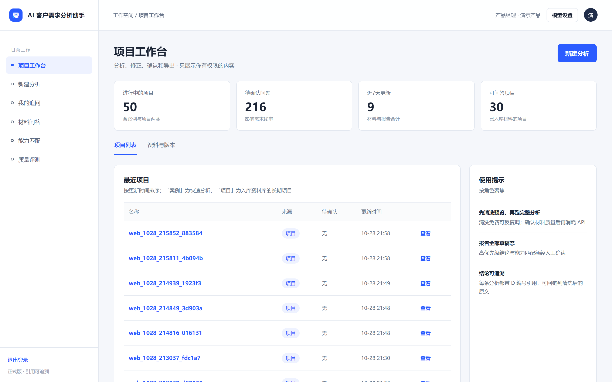
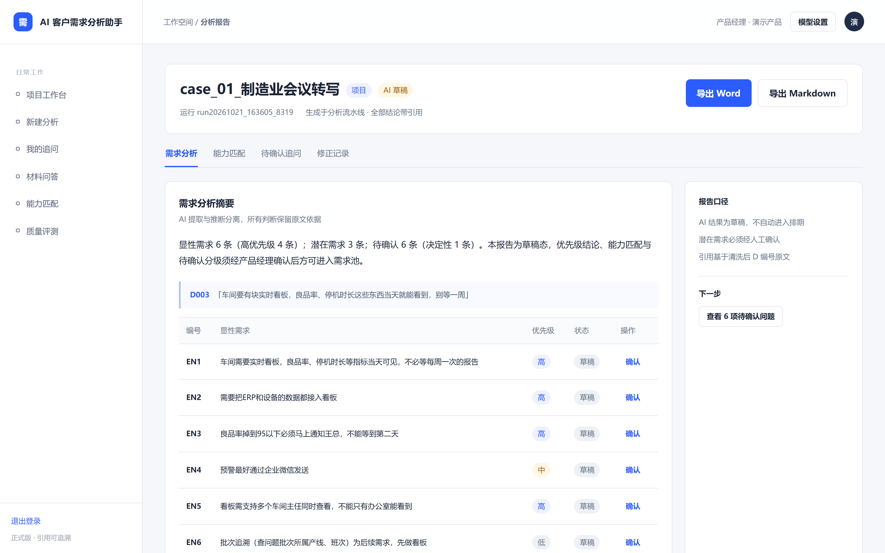
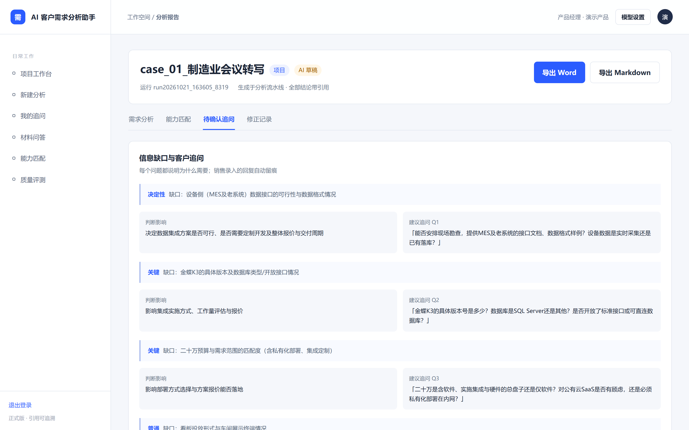
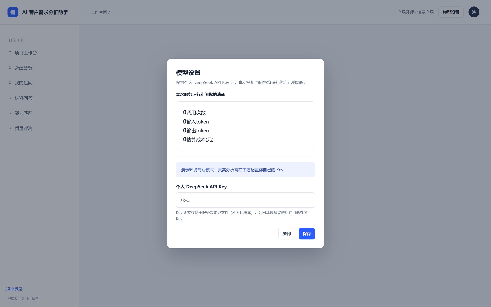
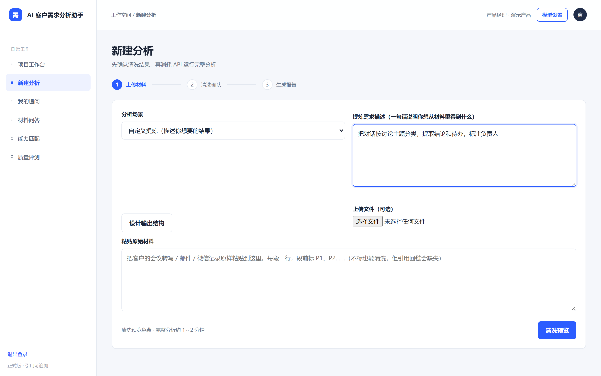
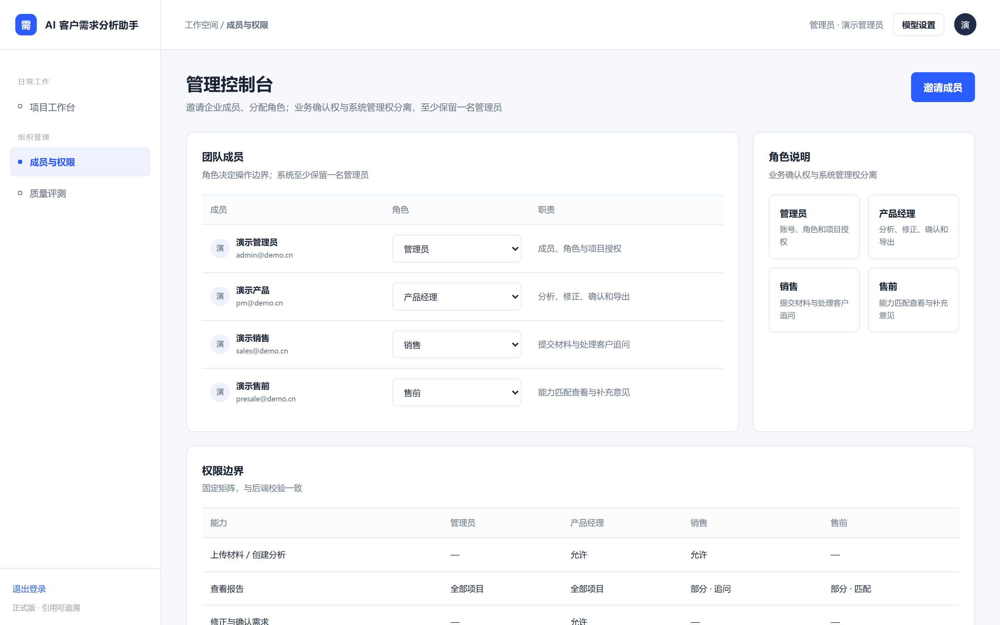
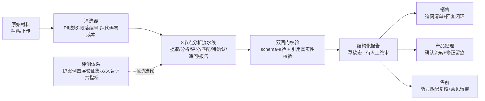
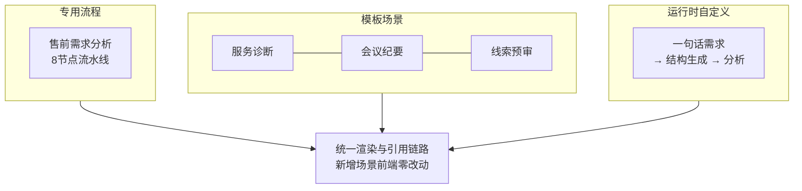

<div align="center">

# 🎯 AI 客户需求分析助手

**把一小时的会议记录，变成一分钟的可信需求决策**

粘贴客户的会议转写、微信记录或邮件——系统自动产出结构化需求分析：
每一条结论都带原文引用，每一个缺口都配好了追问话术。

[](https://github.com/KeepNever/ai-requirements-analyzer/actions/workflows/ci.yml)
[](#-质量与可信)
[](https://www.python.org)
[](#-设计取舍)
[](#-在线演示)

**在线演示 · 无需部署，打开即用** 👇

| 账号 | 密码 | 角色 |
|---|---|---|
| `pm@demo.cn` | `demo12345` | 产品经理（全功能） |
| `admin@demo.cn` | `demo12345` | 管理员 |
| `sales@demo.cn` | `demo12345` | 销售 |
| `presale@demo.cn` | `demo12345` | 售前 |

🌐 **https://needs-analysis-workbench.app.workbuddy.host**

*演示环境为离线模式；真实分析请在「模型设置」中配置你自己的 DeepSeek Key。*



</div>

---

## 为什么做这个

售前和客户成功同学每天泡在会议转写和微信记录里——客户说了什么需求、缺什么信息，靠人肉翻聊天记录，翻完还要写纪要。

这个系统回答三个问题：

1. **客户到底要什么？**——显性需求与潜在需求分离提取，每条带原文引用（D 编号），可回链脱敏后的原文
2. **信息还缺什么？**——每个缺口说明「为什么影响判断」并给出建议追问，销售带着就能见客户
3. **AI 说的话可信吗？**——17 个双人标注案例的四层验证集持续评测，六项量化指标，弱项诚实挂账

## ✨ 功能速览

| 能力 | 说明 |
|---|---|
| 四角色工作台 | 销售 / 产品经理 / 售前 / 管理员，权限前后端双层校验 |
| 可信 AI 输出 | 引用双闸门 + 草稿态 + 人工终审，全程追加式留痕 |
| 多场景引擎 | 售前分析 / 服务诊断 / 会议纪要 / 线索预审，场景即配置 |
| 自定义提炼 | 一句话描述需求，运行时生成分析结构，长尾全覆盖 |
| 自带模型 BYOK | 演示环境零服务方 Key，用户配自己的 Key 并查看用量 |
| 项目级授权 | 管理员可将项目设为受限，仅授权成员可见 |

## 📸 界面与工作流

### ① 分析报告：结论带引用，缺口带追问

每条显性 / 潜在需求都标记优先级与草稿状态；页首锚定原文（D003），点击可回链脱敏后的段落。待确认页签里，每个信息缺口都有「影响判断」与「建议追问」话术，销售可直接带去见客户。




### ② 草稿态协作：AI 不越权，人做终审

AI 结果不直接进需求池——产品经理逐条「确认」后流转，修正全程留痕；售前在能力匹配页复核结论并沉淀意见。所有标注追加式记录，不覆盖历史。

### ③ 自带模型（BYOK）：消耗的是你自己的额度

公网演示环境不内置任何服务方 Key。用户在「模型设置」配置自己的 DeepSeek Key 后，真实分析消耗自己的额度，用量（调用次数 / token / 成本估算）实时可见。



### ④ 自定义提炼：没有预定义场景也能分析

不选择任何模板场景，用一句话描述「想从材料里得到什么」，系统即时生成输出结构预览（确认后才消耗额度），然后按该结构分析并复用统一的渲染与引用链路——加一个新场景，前端零改动。



### ⑤ 管理控制台：成员、角色与数据边界

管理员邀请成员、调整角色，并可按项目设置受限访问——受限项目对无权成员从列表消失，直连链接返回 404。



## 🏗️ 系统总览



**场景引擎三层结构**（自 V3.2 起）：



## 🚀 快速启动

```bash
# 1. 配置 API Key（不配也能体验清洗预览与离线问答）
cp .env.example .env   # 填入 DEEPSEEK_API_KEY

# 2. 启动 SaaS 工作台
python web_demo.py     # http://127.0.0.1:8000

# 3. 首个注册账号自动成为管理员，在管理控制台邀请成员
```

命令行方式（单案例约 0.3 元，1~2 分钟）：

```bash
python src/run_case.py                 # 离线演示，无需 API Key
python src/run_case.py --real --case 你的材料.md
```

完整操作说明（按角色分步）见 [docs/用户使用手册.md](docs/用户使用手册.md)。

## 🔁 迭代历程

| 里程碑 | 关键交付 | 质量动作 |
|---|---|---|
| **V1 分析质量验证** | 8 节点流水线、Prompt 工程、评分与校验层 | 17 案例双人标注验证集、六指标基线、失败留档制度 |
| **V2 多场景引擎** | 场景化架构（JSON 声明式）、版本化存储、引用问答 | 场景评测接入、GT 机制、盲测纪律 |
| **V2.5 SaaS 工作台** | 账号会话、四角色权限、需求确认流转、修正留痕、材料问答 | 权限矩阵测试、 adversarial 对抗测试 |
| **V3 公网演示** | BYOK 模型设置、项目级访问控制、用量展示、服务诊断场景 | 线上实测驱动修复、E2E 验证流程化 |
| **V3.1 引擎统一** | 通用场景渲染器（spec 驱动）、会议纪要 + 线索预审场景、md 导出 | 新场景「前端零改动」实证、GT 锁定判断边界 |
| **V3.2 自定义提炼** | 运行时场景生成（结构设计 → 确认 → 分析）、run 级私有场景 | 结构校验闸门、mock 全链路验证 |
| **V3.3 安全与 CI** | 登录限速、CSRF 头校验、SameSite 升级、GitHub Actions | 142 项测试自动回归、安全行为 E2E 双端验证 |

迭代方法论：**每轮由评测驱动，失败也是产出**——两轮未通过验收的 Prompt 实验完整归因后回滚挂账（见 `docs/experiments/`），弱项转化为产品设计（草稿态 + 人工终审）。

## 🔬 质量与可信

- **评测体系**：17 案例双人标注、四层数据集纪律（开发反复回归 / 冻结阶段收口 / 盲测用后转回归集绝不复用）、六项量化指标、评估器独立版本号
- **失败留档**：`docs/experiments/` 17 篇实验报告，含两轮未通过验收的完整归因与回滚记录——大多数项目只有成功案例，这里连失败都可审计
- **测试**：142 项自动化测试（流水线校验 / 引用防编造 / 权限矩阵 / 账号会话 / 访问控制 / 用量统计 / 登录限速），push 由 GitHub Actions 自动执行
- **安全基线**：PBKDF2 密码哈希 + HMAC 签名会话（HttpOnly / SameSite=Strict）+ 登录失败限速（5 次锁 15 分钟）+ CSRF 头校验
- **零运行时依赖**：LLM 调用、Web 服务、密码哈希全部标准库实现，克隆即跑

<details>
<summary><b>六指标当前状态（诚实口径）</b></summary>

| 指标 | 状态 |
|---|---|
| 提取 F1 | 0.79 |
| 关键遗漏率（盲测） | 0 |
| 引用错位 | 0（EVD-01 校验拦截） |
| 优先级一致率 | 0.397（已知弱项：模型能力边界，两轮 Prompt 实验未达标已挂账，转产品方案补偿） |
| 能力匹配一致率 | 0.61~0.86 |
| 引用完整率 | 持续达标 |

弱项不藏——它定义了「草稿态 + 人工终审」的产品设计，也是评测体系存在的意义。

</details>

## 📁 目录结构

| 位置 | 内容 |
|---|---|
| `webapp/index.html` | SaaS 前端（单文件 SPA，零构建） |
| `web_demo.py` | 标准库 HTTP 服务：页面、API、会话鉴权、角色路由、CSRF 校验 |
| `src/pipeline/` | 分析管线：清洗、提示词、评分、校验、流程编排、LLM 客户端 |
| `scenes/*.json` | 场景模板（声明式：Prompt / 结构 / 引用映射 / 报告渲染） |
| `src/auth.py` | 账号会话（PBKDF2 + HMAC Cookie）+ 权限矩阵 + 登录限速 |
| `src/access.py` | 项目级访问控制 |
| `src/notes.py` | 角色标注：需求确认、客户回复、售前意见（追加式留痕） |
| `src/evaluation/` | 评测器：六指标、GT 加载、场景评测、报告渲染 |
| `docs/experiments/` | 17 篇实验报告 |
| `docs/screenshots/` | 界面截图（README 引用） |
| `prototype/` | 界面设计稿（正式前端由它转正） |

## 🗺️ 路线图

- ✅ V1 分析质量验证（评测闭环）
- ✅ V2 多场景引擎 + 版本化存储 + 引用问答
- ✅ V2.5 SaaS 工作台（账号 / 四角色 / 确认流转 / 修正留痕）
- ✅ V3 公网演示（BYOK / 项目级授权 / 用量统计 / 自定义提炼 / 安全基线 / CI）
- ⏳ V4 团队生产版（SQLite / 分析用量落盘 / 密码找回）——有真实使用方后启动
