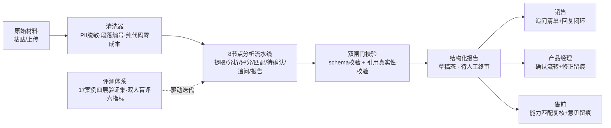

# AI 客户需求分析助手

**30 秒版本**：售前和客户成功同学每天泡在会议转写、微信记录里——客户说了什么需求、缺什么信息，靠人肉翻记录。这个系统把原始材料变成**每条结论可回链原文**的结构化需求报告，并用一套评测体系证明它可靠。

- 输入：会议转写 / 微信记录 / 邮件（脏数据直接粘贴）
- 输出：显性/潜在需求分离、四维优先级评分、能力匹配裁定、信息缺口与追问清单
- 核心承诺：**引用可追溯**——每条结论带 D 编号，可回链脱敏原文；无效引用自动剔除降级

LLM 应用求职作品集 · DeepSeek · 评测驱动迭代 · 124 项自动化测试

## 系统总览



## 快速启动

```bash
# 1. 配置 API Key（分析用；不配也能体验清洗预览与离线问答）
cp .env.example .env   # 填入 DEEPSEEK_API_KEY

# 2. 启动 SaaS 工作台
python web_demo.py     # http://127.0.0.1:8000

# 3. 注册首个账号（自动成为管理员），在管理控制台邀请成员并分配角色
```

命令行方式（单案例 0.3 元，1~2 分钟）：

```bash
python src/run_case.py                 # 离线演示，无需 API Key
python src/run_case.py --real --case 你的材料.md
```

**公网演示环境说明**（`DEMO_MODE=1` 时）：注册关闭，使用预置演示账号登录——

| 账号 | 密码 | 角色 |
|---|---|---|
| admin@demo.cn | demo12345 | 管理员 |
| pm@demo.cn | demo12345 | 产品经理 |
| sales@demo.cn | demo12345 | 销售 |
| presale@demo.cn | demo12345 | 售前 |

演示环境不内置服务方 API Key：真实分析需在「模型设置」中配置你自己的 DeepSeek Key，否则可使用离线演示模式。

## 四角色权限体系

| 能力 | 管理员 | 产品经理 | 销售 | 售前 |
|---|---|---|---|---|
| 上传材料 / 创建分析 | — | ✓ | ✓ | — |
| 查看报告 | 全部 | 全部 | 仅追问清单 | 匹配+追问 |
| 修正与确认需求 | — | ✓ | — | — |
| 我的追问（跨项目+回复闭环） | — | ✓ | ✓ | — |
| 能力匹配复核（+意见留痕） | — | ✓ | — | ✓ |
| 材料问答 | — | ✓ | ✓ | ✓ |
| 成员、角色与授权 | ✓ | — | — | — |

设计取舍：固定四角色矩阵而非自定义 RBAC——业务确认权与系统管理权分离，避免权限组合失控；项目级授权在路线图中。

## 质量与可信

- **引用可追溯双闸门**：Prompt 层约束 + EVD-01 校验层（引用不存在的段落即剔除，全部无效则降级为「证据不足」），基线引用有效率 1.0
- **评测驱动迭代**：17 案例双人标注、四层数据集纪律（开发反复回归 / 冻结阶段收口 / 盲测用后转回归集绝不复用）、六项量化指标、失败实验完整留档回滚（`docs/experiments/` 17 篇）
- **隐私**：原文/脱敏双轨存储，LLM 输入与前端只见脱敏文本；Word 导出失败关闭（脱敏失败输出占位符而非原文）
- **存储纪律**：版本不可覆盖，原文 / 清洗文本 / 分析运行三线留痕
- **124 项自动化测试**，全部合入前必须全绿

## 目录结构

| 位置 | 内容 |
|---|---|
| `webapp/index.html` | SaaS 前端（单文件 SPA，零构建） |
| `web_demo.py` | 标准库 HTTP 服务：页面、API、会话鉴权、角色路由 |
| `src/pipeline/` | 分析管线：清洗、提示词、评分、校验、流程编排、场景引擎 |
| `scenes/*.json` | 场景模板（声明式定义：Prompt / 结构 / 引用映射 / 报告渲染） |
| `src/auth.py` | 账号与会话（PBKDF2 密码哈希 + HMAC 签名 Cookie）+ 权限矩阵 |
| `src/notes.py` | 角色标注存储：需求确认、客户回复、售前意见（追加式留痕） |
| `src/evaluation/` | 评测器：六指标、GT 加载、报告渲染 |
| `tests/` | pytest 单元测试（124 项） |
| `docs/product/` | 产品文档：项目定义、用户角色、范围切分、规划 |
| `docs/experiments/` | 17 篇实验报告（含失败实验完整归因） |
| `docs/v2/` | V2 阶段成果：场景化、评测收口、面试物料包 |
| `prototype/` | 界面设计稿（正式前端由它转正） |

## 路线图

- ✅ V1：分析质量验证（评测闭环）
- ✅ V2：多场景引擎 + 版本化存储 + 引用问答
- ✅ V2.5：SaaS 工作台（账号 / 四角色 / 确认流转 / 修正留痕）
- ⏳ V3：项目级授权、SQLite 化、HTTPS 部署（团队生产版）
